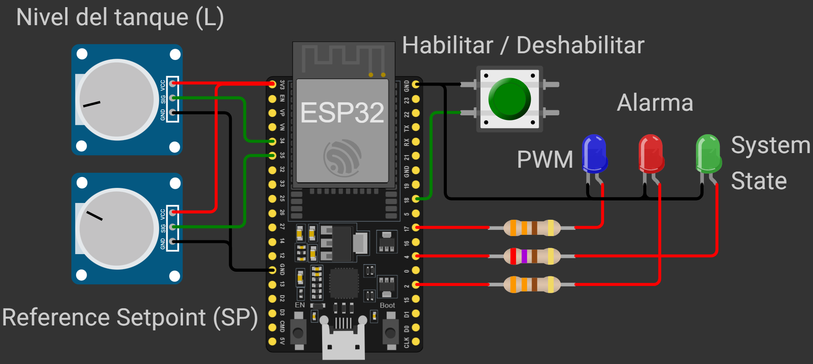
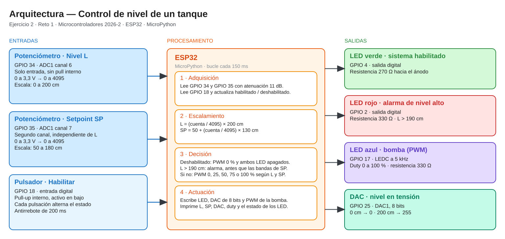
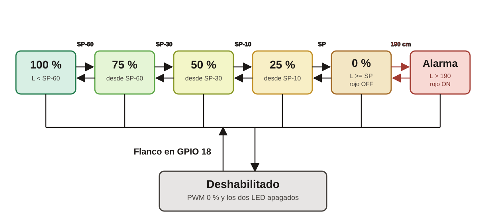

# Programa principal

`reto1.py` es el control que se expone. Dos potenciómetros simulan el nivel del tanque y el nivel deseado. Un pulsador habilita o detiene el sistema. El LED verde indica habilitado, el rojo la alarma, el DAC repite el nivel como tensión y un LED azul con PWM simula la bomba.

## Cómo correrlo

1. Abrir `reto1.py` en Thonny, con el intérprete de MicroPython en la ESP32.
2. Guardarlo en la placa como `main.py`, o ejecutarlo con Run.
3. Girar los potenciómetros y pulsar el botón. Las lecturas salen en el shell de Thonny.

Cada vuelta del lazo espera 150 ms. GND es la referencia común de la ESP32, los potenciómetros, el pulsador y los cátodos de los LED. Los potenciómetros se alimentan entre 3V3 y GND.

## Conexiones

| Señal | Dirección | Periférico | GPIO | Función |
| --- | --- | --- | --- | --- |
| Nivel L | Entrada | ADC1 canal 6 | 34 | Altura del agua, de 0 a 200 cm |
| Nivel deseado SP | Entrada | ADC1 canal 7 | 35 | Altura que se quiere, de 50 a 180 cm |
| Pulsador | Entrada | GPIO con pull-up | 18 | Habilita o detiene. Activo en bajo |
| LED verde | Salida | GPIO | 4 | Sistema habilitado. Resistencia de 270 Ω |
| LED rojo | Salida | GPIO | 2 | Alarma, L mayor que 190 cm. Resistencia de 330 Ω |
| Nivel DAC | Salida | DAC1, 8 bits | 25 | El nivel otra vez como tensión. Medirlo es opcional |
| Bomba | Salida | PWM a 5 kHz | 17 | Velocidad. LED azul con resistencia de 330 Ω |

GPIO 34 y 35 solo admiten entrada. El pulsador no va ahí: no tienen pull-up interno.

## De la cuenta al centímetro

Una cuenta es el número entero del conversor, sin centímetros ni voltios. El ADC es de 12 bits (0 a 4095). El DAC es de 8 bits (0 a 255).

```text
L  = (raw_L  / 4095) × 200
SP = 50 + (raw_SP / 4095) × 130
DAC = (L / 200) × 255
PWM = (porcentaje / 100) × 65535
```

| Nombre | Qué es |
| --- | --- |
| `raw_L`, `raw_SP` | Cuentas del ADC, de 0 a 4095 |
| `L` | Nivel del agua, de 0 a 200 cm |
| `SP` | Nivel deseado, de 50 a 180 cm |
| `DAC` | Ese nivel como cuenta de 0 a 255, en GPIO 25 |
| PWM | Ciclo útil de la bomba, de 0 a 65535 |

El ciclo útil es la fracción de cada pulso en la que el pin queda encendido. Al 0 % está apagado, al 50 % la mitad del tiempo y al 100 % siempre encendido. Por eso el LED azul se ve más o menos brillante.

`duty_u16()` y `.atten(ADC.ATTN_11DB)` se llaman porque la documentación actual de MicroPython las marca como la forma explícita. El código no hereda lo que traiga por defecto cada firmware.

- `duty_u16` mide el ciclo útil de 0 a 65535, y 65535 es siempre el 100 %. La bomba solo usa 0, 25, 50, 75 y 100 %, y el porcentaje se convierte con `(porcentaje / 100) × 65535`.
- 11 dB deja la entrada del ADC de 0 a 3,3 V, el rango de los potenciómetros. En algunos firmware eso ya viene así; escribirlo lo fija en cualquiera.

100 cm dan 127 en el DAC porque `int` trunca 127,5. El DAC sigue al nivel aunque la bomba esté detenida.

## Zonas

La primera condición verdadera gana. Si el sistema está apagado, la bomba se detiene y los dos LED se apagan, aunque el nivel supere 190 cm.

| Condición | PWM | Verde | Rojo |
| --- | --- | --- | --- |
| Deshabilitado | 0 % | OFF | OFF |
| L > 190 cm, habilitado | 0 % | ON | ON |
| L ≥ SP | 0 % | ON | OFF |
| SP − 10 ≤ L < SP | 25 % | ON | OFF |
| SP − 30 ≤ L < SP − 10 | 50 % | ON | OFF |
| SP − 60 ≤ L < SP − 30 | 75 % | ON | OFF |
| L < SP − 60 | 100 % | ON | OFF |

El límite de cada banda pertenece a la zona de arriba: L = SP − 60 es 75 %, L = SP es 0 % y L = 190 cm todavía no es alarma. La alarma pide L estrictamente mayor que 190 cm. Si SP vale 50 cm, SP − 60 queda por debajo de 0 y la zona de 100 % no existe.

Ejemplo con SP = 120 cm:

| Nivel L | Zona | PWM | Rojo |
| --- | --- | --- | --- |
| 40 cm | por debajo de SP − 60 | 100 % | OFF |
| 75 cm | desde SP − 60 | 75 % | OFF |
| 100 cm | desde SP − 30 | 50 % | OFF |
| 115 cm | desde SP − 10 | 25 % | OFF |
| 130 cm | L ≥ SP | 0 % | OFF |
| 195 cm | alarma | 0 % | ON |

## Antirrebote

El pulsador cierra a GND y el pin tiene pull-up, así que oprimido vale 0. Un solo toque puede producir varios flancos. El programa espera 200 ms desde el último flanco aceptado y solo entonces invierte habilitado y deshabilitado.

## Qué imprime

En el shell de Thonny, una línea cada 150 ms:

```text
Estado: HABILITADO   | L: 115.0 cm | SP: 120.0 cm | DAC: 146 | PWM:  25% | LED_V: ON | LED_R: OFF
```

## Diagramas

Esquemático del montaje:



Arquitectura: medir, decidir y actuar.



El archivo editable es [diagramas/diagrama_arq.excalidraw](diagramas/diagrama_arq.excalidraw).

Transiciones entre zonas. El flanco del pulsador apaga la bomba y los dos LED desde cualquiera de ellas, incluida la alarma.



La misma figura, con la escalera de condiciones y la barra del ejemplo, está en [diagramas/diagrama_transiciones.html](diagramas/diagrama_transiciones.html).
